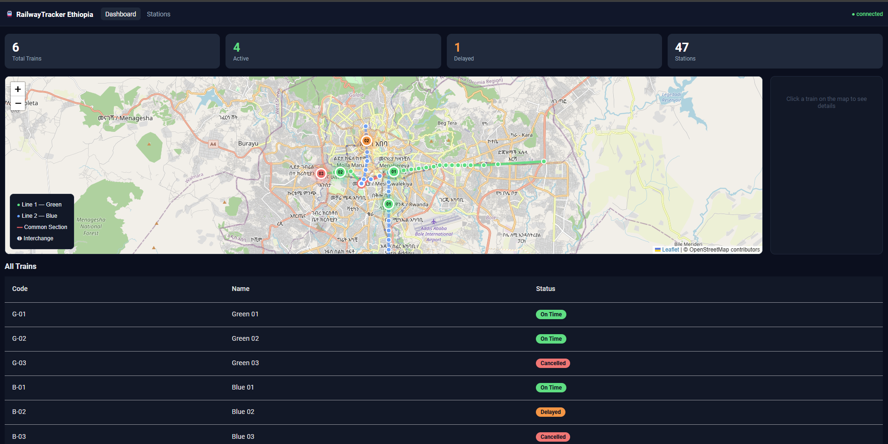
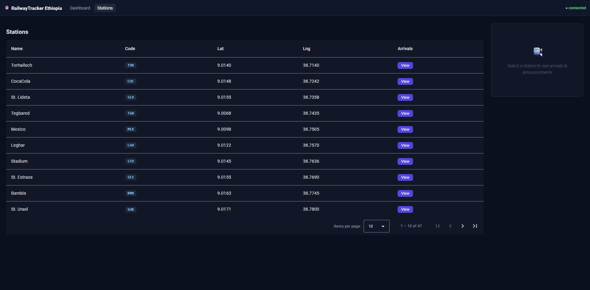

# RailwayTracker Ethiopia: Real-Time Train Monitoring



A full-stack web app for monitoring a city rail network in real time. An ASP.NET Core API built with Clean Architecture streams train positions over SignalR to an Angular dashboard, where everyone sees the same live map, train statuses, station arrivals and announcements. The demo covers two lines and 47 stations in Addis Ababa.

> Personal project built to practise Clean Architecture, CQRS and real-time communication with SignalR. Train movement in the demo is simulated.

## Features

- **Live map:** all trains move on a map of the network. Line 1 is green, Line 2 is blue, the common section is red and interchange stations are marked.
- **Train tracking:** every user sees the same train positions, pushed live over SignalR with no page refresh.
- **Status dashboard:** totals for trains, active trains, delayed trains and stations, plus a table with On Time, Delayed and Cancelled tags.
- **Stations:** a paged table of all 47 stations with codes and coordinates. Select a station to see its arrivals and announcements.
- **ETA:** an estimated arrival time for each station, with delay levels that show how late a train is.
- **Schedules:** planned departure and arrival times per station.
- **Announcements:** delays, cancellations, maintenance and general notices, shown on the dashboard and per station.
- **Staff access:** login-protected pages for authorised staff to publish announcements.
- **Train simulator:** a background service moves trains along their lines to produce demo data.



## Roadmap

- **Your location:** with permission, show where you are and the nearest stations
- **Notifications:** alert users about important changes to their train
- **Favorites:** save your usual stations and routes
- **Admin panel:** let staff update train status directly from the interface

## Tech stack

| Layer | Tools |
|---|---|
| Front end | Angular, TypeScript, SCSS, Leaflet, OpenStreetMap |
| Back end | ASP.NET Core Web API, C# |
| Real time | SignalR hubs for trains and stations |
| Data | Entity Framework Core with migrations and seed data |
| Testing | Unit tests and integration tests |
| Deployment | Docker and Docker Compose |

## Architecture

The API follows Clean Architecture, and each layer depends only on the one inside it. Features use CQRS, with a separate handler for every command and query.

```
RailwayTrackerApi/
├── RailwayTracker.API             Controllers, SignalR hubs, middleware, background services
├── RailwayTracker.Application     Commands, queries, DTOs, ETA calculator, interfaces
├── RailwayTracker.Domain          Entities (Train, Station, Line, Schedule...), enums
├── RailwayTracker.Infrastructure  EF Core, repositories, migrations, data seeder
└── RailwayTracker.Tests           Handler, ETA and API integration tests

railway-client/src/app
├── features    Login, dashboard, stations, announce
├── services    Auth, train and live-sync services
├── store       Application state
├── guards      Route protection
└── models      Shared types
```

## Getting started

You need the .NET SDK, Node.js and the Angular CLI.

**1. Run the API**

```bash
cd RailwayTrackerApi/RailwayTracker.API
dotnet run
```

Or run it with Docker:

```bash
cd RailwayTrackerApi
docker compose up
```

**2. Run the front end**

```bash
cd railway-client
npm install
npm start
```

Open `http://localhost:4200`.

**3. Run the tests**

```bash
cd RailwayTrackerApi
dotnet test
```

## Author

**Yusuf Umer**, Full-Stack & Mobile Developer
[Portfolio](https://yusufumer-portfolio.vercel.app) · [LinkedIn](https://www.linkedin.com/in/yusuf-umer-868b0735a) · yusufumer26@gmail.com